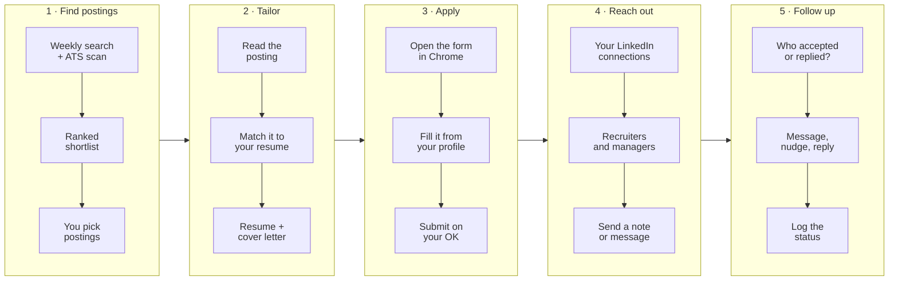
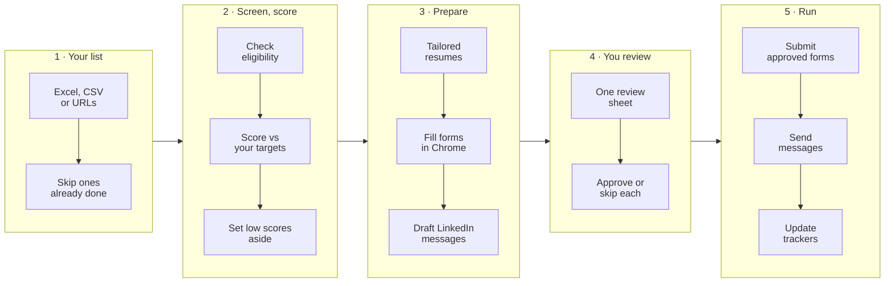
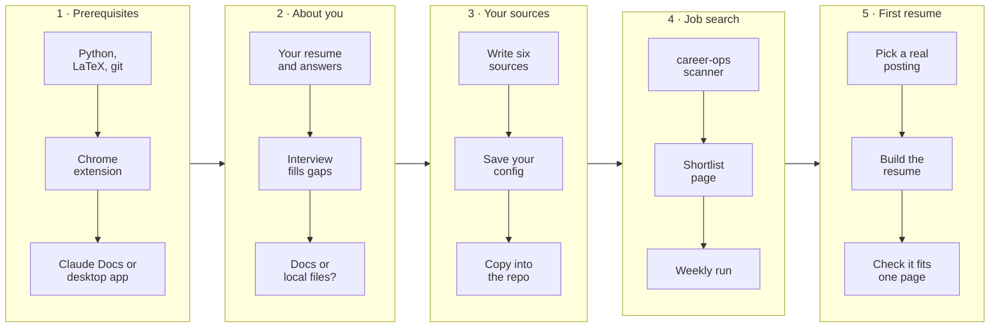

# jobapps

A job-search workspace: tailored resumes and cover letters, application form answers,
and LinkedIn outreach for each posting, driven by Claude Code skills.

## What it does

From finding postings to following up with people at the company. Nothing is submitted, and no
message goes to an existing connection, without your OK.

**Many postings at once:** `/batch` runs the same steps over a whole list, with one review round
for all your approvals.

## Setup

Run `/onboard` in Claude Code: it checks prerequisites, asks for your material and targets, creates your six Docs (or six local files), config, career-ops scan, shortlist and weekly routine (or a local scheduled task).

### How onboarding works

`/onboard` is re-runnable: on a second run it asks "keep / redo" before changing anything that
exists.

### Manual setup (fallback)

1. **Prerequisites.** Python 3; `pdflatex` on PATH, or MiKTeX; Chrome with the Claude in Chrome
   extension (for `/apply`, `/outreach`, `/followup`); the Claude Docs connector, signed in to your
   account (Docs only).
2. **Create your six sources** in Claude Docs, each holding its content in one fenced code
   block (the Mega resume in a `latex` block, the rest in `markdown` blocks), or six local files in
   a folder outside the repo (no code fence): Mega resume, Resume
   prompt, Cover letter prompt, Application profile, Behavioral stories, Free-text answer bank.
   Local files are named like their working copies (`mega-resume.tex`, `resume_prompt.md`, ...).
   The working copies they are pulled into are the six `path` values in `config.example.json`
   (`sources/mega-resume.tex`, `sources/resume_prompt.md`, `sources/cover_letter_prompt.md`,
   `sources/profile.md`, `sources/stories.md`, `sources/answers.md`). The profile needs a
   `## Contact` section (`Full name`, `Preferred first name`, phone, email, links).
3. **Copy `config.example.json` to `config.local.json`** (gitignored) and fill it in. One line per key:
   - `sources` (required): one entry per Doc with its `path`, `doc_url` and `tab_id`; the Profile
     entry also has its `node_id` and `"writable": true`; or, for local files, `path` and `local_path`
     (the file's absolute path), the Profile entry also `"writable": true`. Without the file, skills stop and say
     the repo is not set up yet.
   - `shortlist` (optional): `artifact_url` and `title` of your weekly shortlist artifact. Absent:
     `/job-shortlist` says the shortlist is not set up.
   - `career_ops_dir` (optional): your career-ops checkout, used by `/discover`. Absent: `/discover`
     asks for the path.
   - `discover_locations` (optional): location keywords for `/discover`. Absent: no location filter.
   - `linkedin_premium` (optional): `true` or `false`, the fallback when a LinkedIn run cannot tell
     your plan from the page. Absent: the skill asks you.
   - `targeting` (optional): `eligible_regions`, `home_city`, `currency`, `phone_country`. Absent:
     no eligibility screen, no city or region preference, amounts in USD with no conversion, and
     Workday asks you for the phone country.
4. **Optional:** create a gitignored `.personal-terms` file, one term per line (your name, handles,
   email, phone, Doc ids); `tests/test_no_personal_data.py` then also checks tracked files for them
   locally (CI runs only the generic patterns).
5. **Optional:** set up career-ops for `/discover`, and the weekly shortlist artifact for
   `/job-shortlist`: publish `templates/shortlist/` as the artifact and schedule a weekly routine
   from `templates/weekly-search-prompt.md` (filled in).

## Map

- [`CLAUDE.md`](CLAUDE.md) — how the workspace is laid out and how to work in it.
- Local only, not tracked: `applications.md` (status per posting), `postings/` (per-posting
  folders), `batches/` (`/batch` manifests), `discovered/` (`/discover` CSVs), `dlq.md`, and the personal source files.
- [`.claude/skills/`](.claude/skills/) — `/onboard`, `/discover`, `/resume`, `/cover-letter`, `/apply`, `/outreach`, `/followup`, `/batch`.
- [`templates/`](templates/) — generic starting material `/onboard` uses.
- [`knowledge/`](knowledge/README.md) — what the project knows: research, context, domain docs.
- [`knowledge/decisions/`](knowledge/decisions/README.md) — decision records.
- [`docs/superpowers/`](docs/superpowers/README.md) — design specs and implementation plans.
